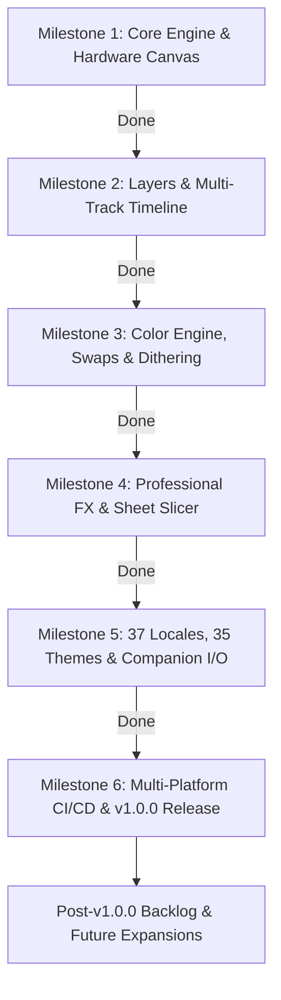

# OniAnvil — Comprehensive Project Context & Architectural Specification

> **Purpose of this Document:**
> This document serves as the single source of truth for the **OniAnvil** project. It provides an exhaustive synthesis of the architectural foundations, technical decisions, engine design, completed milestones, release protocols, and deferred roadmap items. Any AI agent or software engineer joining this project can read this document to instantly recover complete contextual awareness and continue development seamlessly.

---

## 1. Executive Summary & Core Philosophy

- **Project Name:** OniAnvil (`onianvil`)
- **Repository:** `https://github.com/rbm13s/OniAnvil`
- **Current Version:** `v1.0.0` (Production Release)
- **License:** MIT License
- **Author/Maintainer:** rbm13s & OniAnvil Contributors

### The Core Vision
Most existing pixel art tools (such as Aseprite) store projects in opaque, proprietary binary formats (`.ase`/`.aseprite`) that require export steps to become usable in game engines, and treating sprite sheets as secondary export targets rather than first-class editing citizens.

**OniAnvil flips this paradigm:**
1. **Atlas-First Architecture:** The workspace canvas is fundamentally a 2D game-ready texture atlas / sprite sheet (`RgbaImage`). Frames are sub-rectangles sliced by a grid. There is zero translation overhead between what the artist paints and what the game engine renders.
2. **Zero Vendor Lock-in (Dual Companion Storage):** Projects are stored as two co-located files:
   - `character.png` — Standard lossless PNG sprite sheet openable by any image viewer, engine (Godot, Unity, Unreal, Defold), or web tool.
   - `character.onianvil.json` — Human-readable companion metadata sidecar storing layer hierarchies, animation tags, frame durations, playback directions, custom palettes, named skin swaps, pivot points, gameplay action points, and reference sketch transformations.
3. **Cross-Platform & Dependency-Light:** Built in Rust using `egui`/`eframe` and hardware acceleration via `wgpu` on desktop and `glow` on WebAssembly. Native self-contained binaries on Windows, Linux, and macOS Universal (Apple Silicon & Intel).

---

## 2. Technology Stack & Dependencies

| Layer | Component | Version / Target | Details |
| :--- | :--- | :--- | :--- |
| **Language** | Rust | 2021 Edition (1.80+) | Safe memory management, zero-cost abstractions, multi-threading. |
| **GUI Framework** | `egui` / `eframe` | `0.31` | Immediate mode GUI library with custom vector widgets and low latency. |
| **Desktop Graphics** | `wgpu` | Via `eframe` desktop feature | DirectX 12, Vulkan, and Metal hardware-accelerated pipeline. |
| **Web Graphics** | `glow` (WebGL2) | Via `eframe` wasm32 feature | Hardware-accelerated OpenGL ES 3.0 / WebGL2 canvas in modern browsers. |
| **Image Processing** | `image` | `0.25` | Lossless PNG encoding/decoding, GIF animation, WebP, JPEG, ICO. |
| **Serialization** | `serde`, `serde_json` | `1.0` | Companion JSON metadata, persistent app settings, and locales. |
| **Native Dialogs** | `rfd` | `0.15` | Native desktop OS file dialogs (Win32, GTK3/X11, AppKit). |
| **HTTP Client** | `ehttp` | `0.5` | Asynchronous, non-blocking GitHub release update checker. |
| **Base64** | `base64` | `0.22` | Embedded sketch images and WebAssembly local storage serialization. |
| **System Paths** | `directories` | `6.0` | Standard OS paths for local cache, autosaves, and configuration. |
| **Web Builder** | `trunk` | `0.21`+ | WebAssembly bundler compiling `index.html` into `docs/app/`. |
| **Icons & Packaging** | `winresource` | `0.1` | Embedded Windows `.ico` resource (conditionally compiled on desktop only). |

---

## 3. Repository & Directory Structure

```
OniAnvil/
├── .agents/
│   └── skills/
│       ├── release-checklist/SKILL.md  # Mandatory 3-phase release protocol
│       └── ub-mode/SKILL.md            # "First Make It Work, Then Make It Right" principles
├── .github/
│   └── workflows/
│       └── build.yml                   # CI/CD: Linux (deb+tar.gz), macOS Universal (app+zip),
│                                       # Windows (exe+zip), wasm check & automated GitHub Release
├── assets/
│   ├── fonts/                          # Font Awesome Free solid icons (.ttf)
│   ├── locales/                        # 37 localized JSON dictionaries (en.json, ru.json, etc.)
│   ├── samples/                        # Starter demo project (Cat 2D Pixel Art by xzany)
│   └── icon_2048x2048.jpg, icon.ico    # High-resolution logos and icons
├── docs/                               # GitHub Pages static site (HTML, CSS, screenshots)
│   ├── app/                            # Deployed WebAssembly build (index.html, wasm, js, fonts)
│   ├── screenshots/                    # UI showcase screenshots
│   ├── index.html, ru.html, etc.       # 37 localized landing pages
│   └── README-*.md                     # 36 localized README translations
├── src/
│   ├── main.rs                         # Application entry point, window init & font loading
│   ├── app.rs                          # OniAnvilApp state, docking layout, hotkey bindings
│   ├── i18n.rs                         # 37-language i18n manager with 100% dictionary key parity
│   ├── theme.rs                        # 35 ergonomic, console & CRT themes
│   ├── web.rs                          # WASM dynamic font loading queue and browser bindings
│   ├── bin/
│   │   └── generate_changelog.rs       # Categorized GitHub release notes generator
│   ├── canvas/
│   │   ├── mod.rs
│   │   ├── viewport.rs                 # Pan, zoom, coordinate space conversions
│   │   ├── renderer.rs                 # Pixel rendering, checkerboard, onion skin, grid lines
│   │   └── overlays.rs                 # Selection marching ants, gizmos, pivot points
│   ├── history/
│   │   ├── mod.rs
│   │   └── command.rs                  # Undo/Redo stack with resolution-adaptive depth scaling
│   ├── io/
│   │   ├── mod.rs
│   │   ├── storage.rs                  # Atomic companion file saving (.png + .onianvil.json)
│   │   ├── autosave.rs                 # 45-second background autosave and crash recovery
│   │   ├── export.rs                   # Extruded border PNG, animated GIF, engine JSON export
│   │   ├── packer.rs                   # Tight texture atlas packing with trimming and POT sizing
│   │   ├── updater.rs                  # Asynchronous GitHub Releases update check
│   │   └── settings.rs                 # App settings, recent files, recent colors
│   ├── model/
│   │   ├── mod.rs
│   │   ├── project.rs                  # Core Project: atlas buffer, layer compositing, slicing
│   │   ├── document.rs                 # Document container with undo history
│   │   ├── frame.rs                    # Frame metadata, tag directions, layer blend modes
│   │   ├── metadata.rs                 # Companion JSON serialization schema
│   │   ├── palette.rs                  # 25+ retro palettes, live swaps/skins, Bayer dithering
│   │   └── sketch.rs                   # Background reference sketch state and sampling
│   ├── tools/
│   │   ├── mod.rs                      # Active tool definition, brush sizes, stamp brushes
│   │   ├── stroke.rs                   # Bresenham lines, 1px Pixel-Perfect corner cleaner
│   │   ├── fill.rs                     # BFS queue flood fill, gradients, HSV adjustments
│   │   ├── shapes.rs                   # Rectangles, ellipses, 3-click quadratic Bézier curves
│   │   ├── selection.rs                # Rect marquee, 8-connected polygon lasso, magic wand
│   │   ├── filters.rs                  # 3x3 convolution kernels (blur, sharpen, edge, emboss)
│   │   └── transforms.rs               # RotSprite, arbitrary rotation, Scale2x upscaling
│   └── ui/
│       ├── mod.rs
│       ├── top_bar.rs                  # Global menu bar (File, Edit, Project, View, Select, Help)
│       ├── left_dock.rs                # 15-tool palette sidebar, tool properties
│       ├── center_workspace.rs         # Hardware canvas viewport host
│       ├── right_dock.rs               # Layers, frame tags, palette skins, preview player
│       ├── bottom_dock.rs              # Multi-track animation timeline with hold multipliers
│       ├── color_picker.rs             # RGB/HSV sliders, two-point color ramp generator
│       ├── start_screen.rs             # Recents, New Project Wizard, Cat demo starter
│       └── modals.rs                   # Advanced dialogs (Slicer, 9-Grid, RotSprite, Palette Remap)
├── build.rs                            # Windows resource compiler integration (gated from wasm)
├── build_wasm.ps1, build_wasm.sh       # Convenience WebAssembly compilation scripts
├── Cargo.toml                          # Dependency manifest and target configurations
├── index.html                          # Root WebAssembly template for Trunk
├── Trunk.toml                          # Trunk compilation and build server config
└── README.md                           # Master English project documentation
```

---

## 4. Architectural & Technical Decisions

### 4.1. Atlas-First Data Model
Instead of storing isolated individual frame images in memory and stitching them only upon export, `OniAnvil` maintains the entire project atlas as a unified 2D pixel buffer (`RgbaImage` in `src/model/project.rs`).
- Slices are derived on the fly:
  $$\text{Cell Origin X} = (\text{frame\_index} \pmod{\text{columns}}) \times \text{frame\_width}$$
  $$\text{Cell Origin Y} = (\text{frame\_index} \mathbin{/} \text{columns}) \times \text{frame\_height}$$
- **Benefits:**
  - Zero discrepancies between timeline preview and exported game atlas.
  - Seamless switching between **Frame View** (focusing on one frame) and **Atlas View** (viewing the entire grid).
  - Direct hardware upload to GPU textures (`egui::TextureHandle`) with nearest-neighbor texture sampling.

### 4.2. Multi-Layer Compositing Engine
- Each frame in the atlas supports multiple discrete layers (`src/model/frame.rs`):
  - Layer properties: `name`, `visible`, `opacity` ($0.0..=1.0$), `locked`, `blend_mode` (Normal, Multiply, Screen, Overlay, Darken, Lighten, Color Dodge, Color Burn).
  - When editing a specific layer, strokes only mutate pixels belonging to that layer.
  - The composite view is generated on CPU via multi-layer pixel blend equations and uploaded to the GPU texture cache.

### 4.3. Dual Companion Storage Architecture
- Projects are saved as `filename.png` and `filename.onianvil.json`.
- **Atomic File Writing (`src/io/storage.rs`):**
  - To prevent file corruption during OS crashes, unexpected power loss, or write interruptions, OniAnvil writes both the `.png` and `.json` to `.tmp` files first (`filename.png.tmp`, `filename.json.tmp`).
  - Once both writes succeed, the files are atomically renamed to their final targets via `std::fs::rename`. If any write fails, all temporary files are cleaned up and the original project remains untouched.
- **Background Autosave & Crash Recovery (`src/io/autosave.rs`):**
  - Runs in the background on a 45-second timer.
  - Skips disk writes if no changes occurred (`unsaved_changes == false`).
  - Uses raw byte comparisons (`chunks_exact(4)`) to minimize overhead.
  - Native recovery files are stored in OS app-data directories (`directories::ProjectDirs`). WebAssembly builds serialize to browser `LocalStorage`.

### 4.4. Adaptive History Stack (OOM Prevention)
- History snapshots (`HistorySnapshot` in `src/history/command.rs`) store atlas state and metadata diffs for undo/redo.
- Storing 100 full copies of huge atlases ($2048 \times 2048$ RGBA) would consume several gigabytes and trigger Out-Of-Memory (OOM) crashes.
- OniAnvil employs **resolution-adaptive depth scaling**:
  - $\le 256 \times 256$ pixels $\rightarrow$ **100 undo steps**
  - $\le 512 \times 512$ pixels $\rightarrow$ **60 undo steps**
  - $\le 1024 \times 1024$ pixels $\rightarrow$ **30 undo steps**
  - $> 1024 \times 1024$ pixels $\rightarrow$ **15 undo steps**

### 4.5. Hardware Canvas & Viewport Rendering
- Infinite sub-pixel panning with mouse wheel drag or middle mouse button.
- Cursor-centered zooming from $10\%$ to $6400\%$.
- Custom shaders and overlay passes in `src/canvas/renderer.rs`:
  - Checkerboard transparency background with customizable light/dark/CRT patterns.
  - Sub-pixel grid rendering that gracefully fades when zoomed out to prevent visual moiré noise.
  - **Multi-Frame Onion Skinning:** Configurable ghosting with colored tints (green for past frames, red for future frames) and adjustable opacity falloff.
  - **Selection Marching Ants:** Animated dual-tone boundary outline for active selections.
  - **Action & Pivot Gizmos:** Visual crosshairs for sprite anchor points, weapon sockets, and collision boxes.

### 4.6. Precision Pixel Tools & Algorithms
1. **Pixel-Perfect Pencil (`src/tools/stroke.rs`):**
   - Automatically eliminates undesirable $2 \times 2$ "staircase L-corners" on 1-pixel line strokes while preserving intended pixel clusters.
2. **Robust Polygon Lasso (`src/tools/selection.rs`):**
   - Implements 8-connected boundary rasterization with 4-connected exterior flood-fill.
   - Eliminates interior hole dropouts even on complex self-intersecting lasso loops.
3. **Queue-Based BFS Flood Fill (`src/tools/fill.rs`):**
   - High-performance queue-based breadth-first search with configurable color tolerance ($0..=255$). Supports contiguous vs. global color replacement.
4. **RotSprite Arbitrary Rotation (`src/tools/transforms.rs`):**
   - Implements the classic RotSprite algorithm (Scale8x + directional sampling + intermediate error reduction), allowing arbitrary angle rotation of pixel art without blurring.
5. **3x3 Matrix Convolutions (`src/tools/filters.rs`):**
   - Blur, Sharpen, Edge Detect, and Emboss filters with transparency/alpha preservation.
6. **Extruded Atlas Export (`src/io/export.rs`):**
   - Duplicates outer frame pixel borders into transparent margins to prevent texture bleed during bilinear filtering and mipmapping in 3D and 2D game engines.

### 4.7. Advanced Color Engine & Palette System
- Over 25 authentic retro palettes:
  - **DawnBringer:** DB8 (8 colors), DB16 (16 colors), DB32 (32 colors) by Richard Fhager.
  - **Windows 95 (256):** Complete classic 256-color system palette.
  - **Retro Consoles & Systems:** PICO-8, NES (55), SNES (32), Game Boy (4), GBC (31), Sega Genesis (34), Atari 2600 (104), Commodore 64 (16), ZX Spectrum (15), CGA (16), EGA (64), Amstrad CPC (27), MSX (15), Apple II (15).
- **Instant Palette Swapping (Skins):** Allows defining multiple skin variants (e.g. Default, Golden Armor, Shadow, Frozen). Swapping skins performs an instant single-pass remap across the entire atlas buffer.
- **Quantization & Dithering:** Converts arbitrary art into active palettes using Bayer 2x2, 4x4, 8x8, or Blue Noise dithering with strength control.
- **Two-Point Color Ramp Generator:** Generates smooth perceptual gradients between two selected colors.
- **Import/Export:** Full support for `.gpl` (GIMP Palette), `.pal` (JASC PAL), `.hex`, and PNG palette image swatches.

### 4.8. Localization & Theme Engine
- **37 Locales (`src/i18n.rs`):** English, Russian, Ukrainian, Belarusian, Kazakh, Georgian, Armenian, Azerbaijani, Uzbek, German, French, Spanish, Italian, Portuguese, Polish, Czech, Slovak, Slovenian, Bulgarian, Serbian, Croatian, Dutch, Danish, Norwegian, Swedish, Finnish, Estonian, Latvian, Lithuanian, Hungarian, Romanian, Greek, Turkish, Japanese, Korean, Simplified Chinese, Traditional Chinese.
  - 100% dictionary key parity validated by automated tests (`test_locale_dictionaries_key_parity`).
  - Dynamic font loading queue for non-Latin alphabets on WebAssembly (`web/fonts/NotoSans*.ttf`).
- **35 Themes (`src/theme.rs`):**
  - Modern Studio Dark, Studio Light, Pitch Black, Nord Frost, Dracula, Cyberpunk, Synthwave, Monokai Pro, Tokyo Night, Gruvbox, Catppuccin.
  - Authentic CRT Phosphors: Amber CRT, Green CRT, Cyan CRT.
  - Retro Consoles: PlayStation 1, PlayStation 2, Dreamcast, SNES, Genesis, Game Boy.
  - Vintage Computers: C64, ZX Spectrum, Amiga Workbench, Atari ST, Apple II, DOS CGA, Mac Classic, Windows 98.

---

## 5. Roadmap Status & Milestone Progress



### Completed Milestones (All Shipped in v1.0.0)

- [x] **Milestone 1: Core Engine & Hardware Canvas (Complete)**
  - Atlas-first data model, infinite viewport pan/zoom, nearest-neighbor GPU texture rendering, pixel grid, transparent checkerboard.
  - Core tools: Pencil (Pixel-Perfect), Eraser, Eyedropper, Line, Curve, Rectangle, Ellipse.
- [x] **Milestone 2: Multi-Layer Timeline & Onion Skinning (Complete)**
  - Multi-track timeline dock with per-frame hold multipliers, drag-and-drop reordering, duplicate/delete.
  - Animation tags with custom colors and playback directions (Forward, Reverse, Ping-Pong).
  - Multi-frame onion-skin ghosting with customizable past/future tints.
- [x] **Milestone 3: Advanced Color Engine & Palette System (Complete)**
  - 25+ retro palettes (DB8, DB16, DB32, Windows 95, NES, PICO-8, etc.).
  - Instant character skin swapping with atlas remapping.
  - Bayer & Blue Noise dithering, Shading Brush (Dodge/Burn), color ramp generator, GPL/PAL/HEX import/export.
- [x] **Milestone 4: Professional FX & Game Engine Exports (Complete)**
  - RotSprite arbitrary angle rotation algorithm.
  - 3x3 convolution filters (blur, sharpen, edge detect, emboss).
  - Automatic pixel outline generator (Outside, Inside, Centered).
  - Sheet Slicer with autocorrelation boundary detection.
  - 9-grid (9-slice) UI scalable preview modal.
  - Extruded border PNG, animated GIF, and standard game engine JSON export.
- [x] **Milestone 5: Internationalization, Theming & Reliability (Complete)**
  - Full native UI localization across 37 languages with 100% key parity.
  - 35 curated themes (modern, retro consoles, vintage computers, CRT phosphors).
  - Atomic file saving (`.tmp` + rename) and 45-second background autosave crash recovery.
  - Non-blocking asynchronous GitHub release update checker (`ehttp`).
- [x] **Milestone 6: Multi-Platform Release & GitHub Pages Deployment (Complete)**
  - GitHub Actions CI/CD matrix:
    - Linux (`OniAnvil-linux-x86_64.tar.gz` + `onianvil_*_amd64.deb`)
    - macOS Universal (`OniAnvil-macos-universal.zip` with Apple Silicon + Intel binary)
    - Windows (`OniAnvil-windows-x86_64.zip` with embedded icon)
    - WebAssembly build deployed to GitHub Pages (`docs/app/`)
  - Automated categorized release notes via `src/bin/generate_changelog.rs`.
  - Production Release `v1.0.0` tagged and published.

---

## 6. Deferred Features & Backlog (Post-v1.0.0 Ideas)

These items were analyzed, designed, or discussed during development and intentionally deferred for future minor/major releases:

1. **Issue 2.2 — WebAssembly Dual File Download (Deferred):**
   - In browser builds, saving both `.png` and `.json` in quick succession can trigger browser multi-download blockers or prompt the user twice.
   - *Status:* Deferred because native desktop builds are the primary production targets, while the web version remains an experimental preview. Future solution: package into a single `.zip` file on WASM.
2. **Audio Sync Track for Animation Timeline:**
   - Ability to import `.wav`/`.ogg` audio files and display a waveform track on the bottom timeline.
   - Allows synchronizing pixel animation frames with audio cues (footsteps, weapon swings, spell impacts).
3. **Tilemap & Autotile Mode (16-Pipe / Wang Bitmasking):**
   - Specialized canvas view for painting repeating terrain tiles with live 3x3 neighbor connection rules and collision mask tagging.
4. **2D Skeletal / Mesh Warping (Puppet Animation):**
   - Lightweight 2D bone deformation system allowing keyframing rotation of character limbs without manually repainting every frame from scratch.
5. **Scripting & Extension API (Lua or Rhai):**
   - Embedded scripting environment enabling the community to write procedural pixel generators, custom dither brushes, batch processing scripts, and custom engine export formats.
6. **Native Game Engine Import Plugins:**
   - Official Godot GDExtension / editor plugin and Unity package that directly watches `.onianvil.json` and automatically imports sprite frames, collision shapes, pivot points, and animations without manual setup.
7. **Real-Time P2P Collaborative Editing:**
   - Multi-cursor networked painting using CRDT (Conflict-free Replicated Data Types) or state synchronization over WebRTC for pair sprite art.

---

## 7. Mandatory Release Protocol & Operational Rules

Whenever preparing or cutting a new release, all contributors and agents **must strictly adhere** to the 3-phase release procedure specified in [`.agents/skills/release-checklist/SKILL.md`](.agents/skills/release-checklist/SKILL.md):

### Phase 1: Local Preflight & Version Tagging
1. Run local test suite:
   ```powershell
   cargo test --release
   cargo check --target wasm32-unknown-unknown
   cargo clippy --all-targets -- -D warnings
   ```
   *Must pass with 0 errors and 0 warnings.*
2. Bump `version = "X.Y.Z"` in `Cargo.toml`.
3. Commit and push:
   ```powershell
   git commit -am "chore(release): bump version to vX.Y.Z"
   git push origin main
   ```
4. Tag and push:
   ```powershell
   git tag -a vX.Y.Z -m "OniAnvil vX.Y.Z: <Summary>"
   git push origin vX.Y.Z
   ```

### Phase 2: GitHub Actions CI Verification
1. Monitor GitHub Actions release pipeline. Wait until Linux, macOS, Windows, and Release jobs succeed.
2. Confirm presence of all 4 published binary assets:
   - `OniAnvil-windows-x86_64.zip`
   - `onianvil_X.Y.Z_amd64.deb`
   - `OniAnvil-linux-x86_64.tar.gz`
   - `OniAnvil-macos-universal.zip`

### Phase 3: WebAssembly Rebuild & Docs Sync (Branch `main` Only)
1. Recompile WebAssembly app into `docs/app/`:
   ```powershell
   .\build_wasm.ps1
   ```
2. Update version references and download links across `README.md`, `docs/README-*.md`, and `docs/*.html`.
3. Commit and push to `main`:
   ```powershell
   git add docs/app/
   git commit -am "docs(release): sync documentation and deploy web app for vX.Y.Z"
   git push origin main
   ```
4. **CRITICAL RULE:** **NEVER move, re-tag, or force-push the existing `vX.Y.Z` tag!** Changes to documentation and web app assets belong strictly in `main`. Moving a tag re-triggers expensive, redundant GitHub Actions matrix builds.

---

## 8. Summary of Recent Fixes (Leading to v1.0.0)

- **ReGrid Modal:** Added clamping guard (`self.new_columns.clamp(1, total.max(1))`) preventing division-by-zero panics when resizing grids.
- **New Project Wizard:** Added 8192×8192 maximum dimension guard preventing accidental allocation of multi-gigabyte texture atlases.
- **Autosave Performance:** Replaced expensive pixel parsing with raw 4-byte chunk iteration and bypass on unchanged projects.
- **WASM Build Guard:** Conditional compilation in `build.rs` to stop `winresource` execution on `wasm32-unknown-unknown`.
- **Typo Corrections:** Fixed misspelled screenshot assets (`checkerboard`, `scroll`) across 75 markdown and HTML documents.
- **Tools Table Formatting:** Stripped unicode escape literals (`\u{...}`) next to emojis in all 37 documentation tables.
- **Repository Branding:** Configured GitHub repository About description, homepage URL, and 17 search topics via GitHub REST API.
