<div align="center">

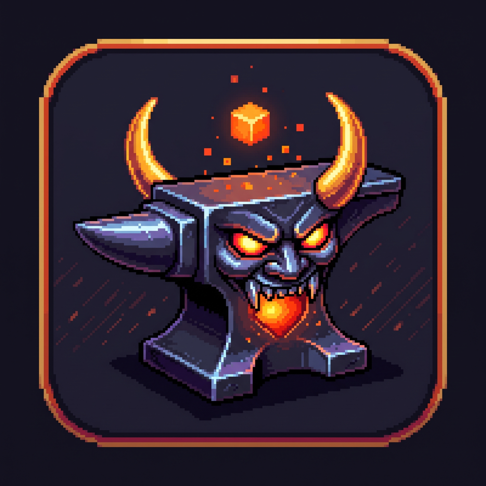

# OniAnvil

**Студио за пикселно изкуство и покадрова анимация (Onion-Skinning) на базата на игрални атласи**

[](https://github.com/rbm13s/OniAnvil/actions/workflows/build.yml)
[](https://github.com/rbm13s/OniAnvil/releases)
[](https://www.rust-lang.org/)
[](https://github.com/emilk/egui)
[](https://wgpu.rs/)
[](#10-35-ергономични-теми-и-пълна-локализация)
[](#бърз-старт)
[-yellow?logo=webassembly)](https://rbm13s.github.io/OniAnvil/app/?lang=bg)
[](../LICENSE)

<br/>

👉 **[🚀 Стартирай OniAnvil в браузъра (WebAssembly)](https://rbm13s.github.io/OniAnvil/app/?lang=bg)** *(⚠️ Експериментална уеб версия: възможни са ограничения и грешки)* • **[🌐 Официален сайт с документация](https://rbm13s.github.io/OniAnvil/bg.html)**

<br/>

**Languages / Языки / Мови / Sprachen / 语言:**<br/>
[English](../README.md) •
[Русский](README-ru.md) •
[Українська](README-uk.md) •
[Беларуская](README-be.md) •
[Қазақша](README-kk.md) •
[ქართული](README-ka.md) •
[Հայերեն](README-hy.md) •
[Azərbaycan](README-az.md) •
[Oʻzbekcha](README-uz.md) •
[Deutsch](README-de.md) •
[Français](README-fr.md) •
[Español](README-es.md) •
[Italiano](README-it.md) •
[Português](README-pt.md) •
[Polski](README-pl.md) •
[Čeština](README-cs.md) •
[Slovenčina](README-sk.md) •
[Slovenščina](README-sl.md) •
**Български** •
[Српски](README-sr.md) •
[Hrvatski](README-hr.md) •
[Nederlands](README-nl.md) •
[Dansk](README-da.md) •
[Norsk](README-no.md) •
[Svenska](README-sv.md) •
[Suomi](README-fi.md) •
[Eesti](README-et.md) •
[Latviešu](README-lv.md) •
[Lietuvių](README-lt.md) •
[Magyar](README-hu.md) •
[Română](README-ro.md) •
[Türkçe](README-tr.md) •
[Ελληνικά](README-el.md) •
[简体中文](README-zh-cn.md) •
[繁體中文](README-zh-tw.md) •
[日本語](README-ja.md) •
[한국어](README-ko.md)

</div>

---

## Съдържание

- [Въведение](#въведение)
- [Екранни снимки и визуална разходка](#екранни-снимки-и-визуална-разходка)
- [Пълен справочник на инструментите (Tools)](#пълен-справочник-на-инструментите-tools)
- [Функционална документация](#функционална-документация)
  - [1. Атласът като единствен източник на истина](#1-атласът-като-единствен-източник-на-истина)
  - [2. Многопистова времева линия на слоевете](#2-многопистова-времева-линия-на-слоевете)
  - [3. Преглед на анимацията на живо в реално време](#3-преглед-на-анимацията-на-живо-в-реално-време)
  - [4. Усъвършенствана система за прозрачно наслагване (Onion Skinning)](#4-усъвършенствана-система-за-прозрачно-наслагване-onion-skinning)
  - [5. Слой за скици и трасиране на референции](#5-слой-за-скици-и-трасиране-на-референции)
  - [6. Прецизен набор за селекция и „маршируващи мравки“](#6-прецизен-набор-за-селекция-и-маршируващи-мравки)
  - [7. Ефекти на живо, филтри и RotSprite](#7-ефекти-на-живо-филтри-и-rotsprite)
  - [8. Управление на палитри, замяна и скинове на герои](#8-управление-на-палитри-замяна-и-скинове-на-герои)
  - [9. Изрязване на спрайт-листове, 9-Grid UI и експорт за игрови двигатели](#9-изрязване-на-спрайт-листове-9-grid-ui-и-експорт-за-игрови-двигатели)
  - [10. 35 ергономични теми и пълна локализация](#10-35-ергономични-теми-и-пълна-локализация)
- [Клавишни комбинации и управление](#клавишни-комбинации-и-управление)
- [Бърз старт](#бърз-старт)
  - [Готови изпълними файлове](#готови-изпълними-файлове)
  - [Компилиране от изходен код](#компилиране-от-изходен-код)
- [Файлов формат и архитектура на проекта](#файлов-формат-и-архитектура-на-проекта)
- [Участие в проекта и благодарности](#участие-в-проекта-и-благодарности)
- [Лиценз и отказ от гаранции](#лиценз-и-отказ-от-гаранции)

---

## Въведение

**OniAnvil** (*името произлиза от **Oni**on-Skinning (покадрова калка) + **Anvil** (наковалня за коване на спрайтове)*) е софтуер с отворен код, създаден на езика Rust за високоефективно рисуване на пикселно изкуство и покадрова анимация. Приложението работи нативно с хардуерно ускорение на графичната карта под Windows, Linux и macOS, както и директно в уеб браузъра чрез WebAssembly без нужда от инсталиране.

За разлика от традиционните редактори, където анимацията се третира като купчина несвързани файлове, принуждаващи разработчика към досадно изрязване, експортиране и повторно пакетиране, **OniAnvil поставя в центъра текстурния атлас (`atlas_rgba`)**. Кадрите, слоевете, анимационните етикети и опорните точки на колизиите се поддържат в постоянна неразрушителна синхронизация с общата текстурна карта.

### Защо OniAnvil?
- 🚀 **Светкавична производителност на Rust**: незабавно стартиране за части от милисекундата, кристално чист рендеринг чрез `wgpu` и `egui 0.31`, нулева латентност при превъртане на дълги времеви линии.
- 🎬 **Монтажна многопистова времева линия**: слоеве във вид на писти (`V1, V2, V3...`) с наслагване отгоре надолу, сливане на слоеве, свързани кадри и гъвкав множител за задържане.
- 🧅 **Първокласен Onion Skinning**: многокадрово калкиране с независимо тониране на предишните и следващите кадри (червено/синьо), плавно избледняване на прозрачността и безшевно зацикляне.
- 🎨 **Мигновени скинове за герои**: създаване на цветови вариации (ден/нощ, отборни цветове, стихии) чрез хардуерно пренасочване на палитрата директно в атласа с поддръжка на GPL, PAL, HEX.
- 📦 **Директна готовност за игрови двигатели**: експорт на PNG с екструдиране на крайните пиксели (премахване на нежелани шевове при филтрация в 2D двигатели като Godot, Bevy, Raylib, Defold), оптимизирани анимирани GIF файлове и стандартен Sprite Sheet JSON.

---

## Екранни снимки и визуална разходка

<div align="center">

### 1. Основно работно пространство и платно
*Високопроизводителен пикселен интерфейс с хардуерно ускорено платно, многопистова времева линия, визуализация на анимацията в реално време, палитра и прецизни ленти с инструменти.*
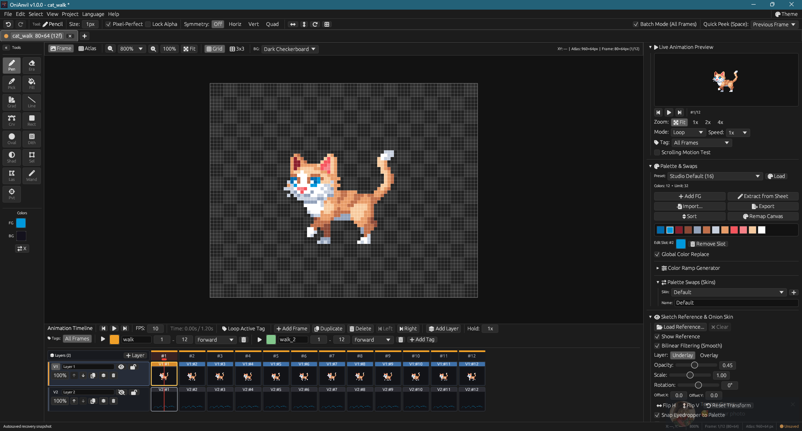

<br/><br/>

### 2. Многопистова времева линия за анимация
*Нелинейна многопистова времева линия със стек от слоеве (`V1, V2...`), свързани копия на кадри (`🔗`), множители за задържане (hold) и именувани цветни етикети.*
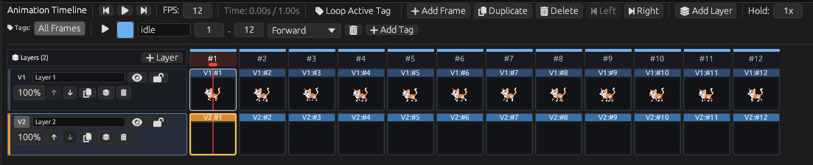

<br/><br/>

### 3. Прецизни инструменти и горна лента за бързи действия
*Пълен набор от 15 инструмента за рисуване със стандартен и компактен режим на докинг, заедно с горна лента за бързо регулиране на размера на четката, симетрията, зациклянето и Pixel-Perfect режима.*
<p align="center">
  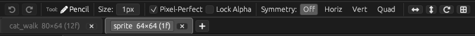<br/><br/>
  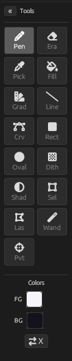
  &nbsp;&nbsp;&nbsp;&nbsp;
  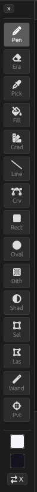
</p>

<br/><br/>

### 4. Преглед на анимацията на живо в реално време
*Специализиран панел за интерактивно възпроизвеждане с филтриране по етикети, контрол на скоростта (FPS), мащабиране и превключване на фона (тъмен шахмат, светъл шахмат, плътен цвят).*
<p align="center">
  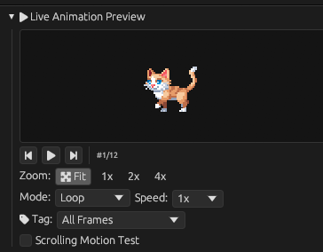
  &nbsp;&nbsp;&nbsp;&nbsp;
  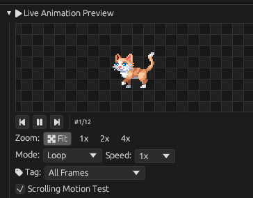
</p>

<br/><br/>

### 5. Палитра, превключване на цветове и скинове
*Цялостна система за управление на цветовете с избор на преден и заден план, автоматично генериране на плавни двуточкови преливки и създаване на именувани скинове за герои.*
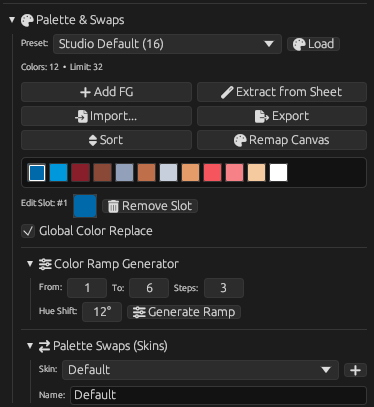

<br/><br/>

### 6. Слой за скици (калка) и конфигурируем Onion Skinning
*Зареждане на концептуално изкуство или снимки под платното с мащабиране, прозрачност, интелигентна пипета с автоматично прилепване към палитрата и многокадрово осветяване на фазите на движение.*
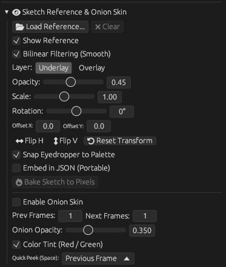

<br/><br/>

### 7. Опорни точки (Pivot) и маркери за игрови действия (Action Points)
*Интерактивно позициониране на центъра на спрайта (Pivot) и персонализирани игрови точки (дуло на оръжие, точка на удар, глава, стъпки) с експортиране в JSON метаданни.*
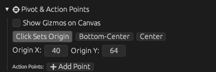

<br/><br/>

### 8. Изрязване на спрайт-листове (Sheet Slicer) и 9-Grid (9-Slice) мащабиране
*Автоматично откриване на границите на кадрите чрез автокорелация (например стъпки на котка) и настройка на 9-секционни мащабируеми елементи на интерфейса.*
<p align="center">
  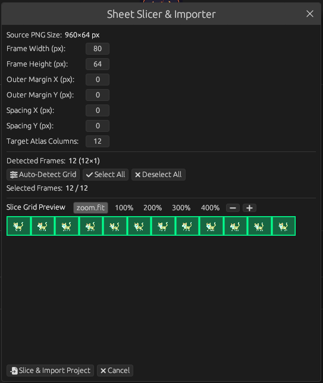
  &nbsp;&nbsp;&nbsp;&nbsp;
  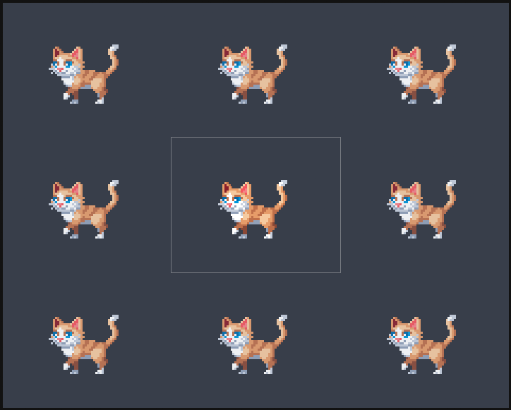
</p>

<br/><br/>

### 9. Графични ефекти и филтри в реално време (с Live Preview)
*Всички диалогови прозорци за ефекти разполагат с визуализация на живо върху платното, интерактивни пипети и безследно отменяне на промените при отказ.*
<p align="center">
  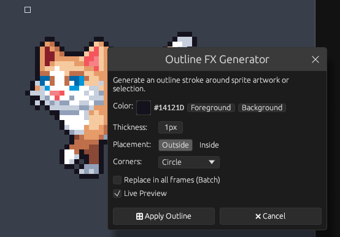
  &nbsp;&nbsp;&nbsp;&nbsp;
  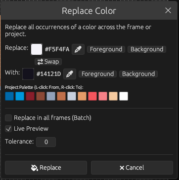
</p>
<p align="center">
  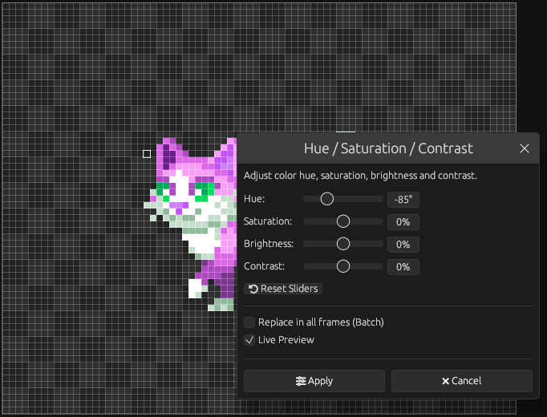
  &nbsp;&nbsp;&nbsp;&nbsp;
  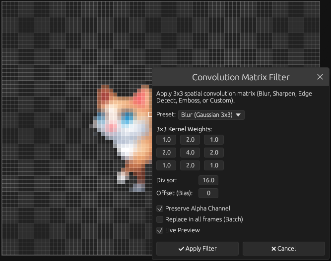
</p>
<p align="center">
  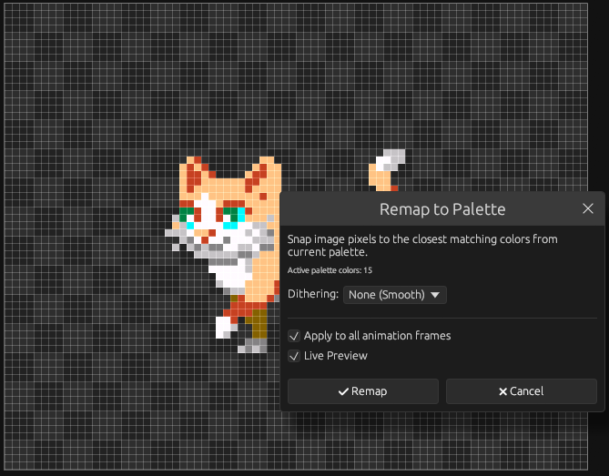
</p>

<br/><br/>

### 10. Режими на мрежата и фонове на платното
*Плавно превключване между пикселна мрежа, мрежа от плочки, тъмен шахмат, светъл шахмат и плътен персонализиран фонов цвят.*
<p align="center">
  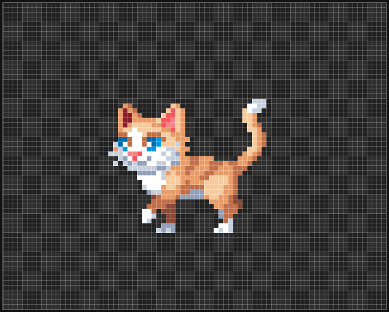
  &nbsp;&nbsp;
  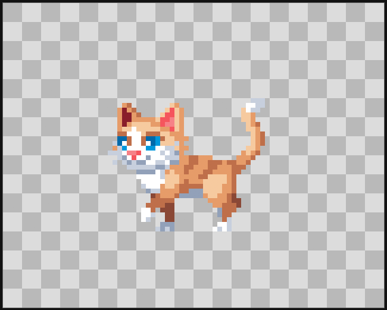
  &nbsp;&nbsp;
  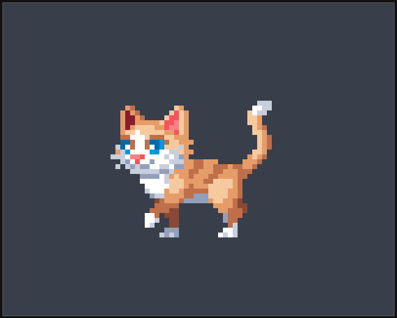
</p>

<br/><br/>

### 11. Съветник за създаване на нов проект
*Бързо конфигуриране на размерите на платното, броя кадри, колонната мрежа на атласа и избор от над 20 автентични ретро палитри при стартиране на проект.*
<p align="center">
  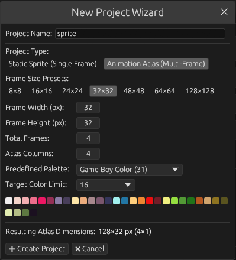
  &nbsp;&nbsp;&nbsp;&nbsp;
  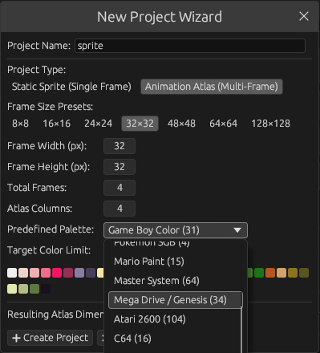
</p>

<br/><br/>

### 12. 35 автентични ретро и модерни теми
*Включва Studio Dark, Studio Light, CRT фосфорни сияния (Amber, Green, Cyan), класически ретро конзоли (PlayStation 1, Game Boy, SNES, Dreamcast, Genesis) и дизайнерски теми.*
<p align="center">
  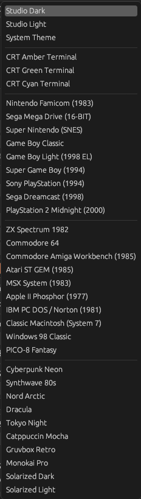
  &nbsp;&nbsp;
  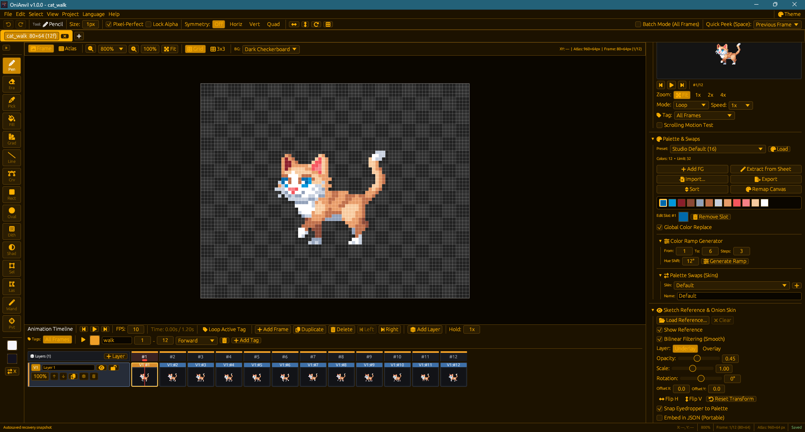
  &nbsp;&nbsp;
  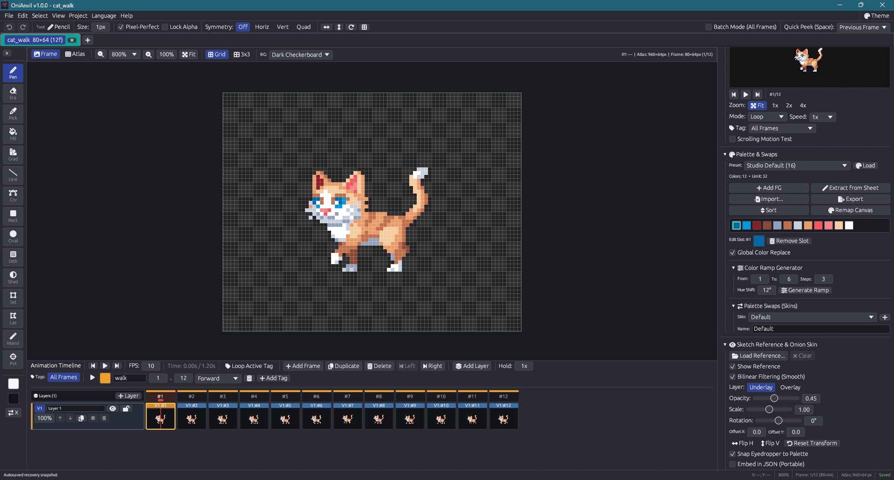
</p>

<br/><br/>

### 13. Система от менюта и вградена помощ за клавишните комбинации
<p align="center">
  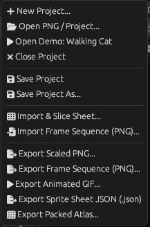
  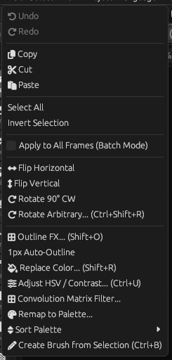
  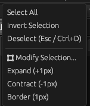
  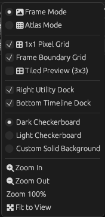
  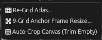
</p>
<p align="center">
  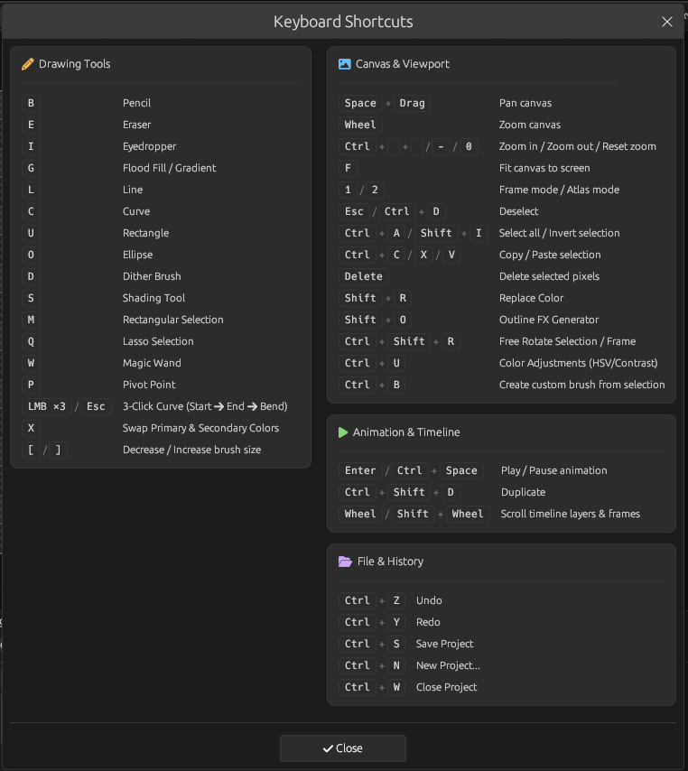
</p>

</div>

---

## Пълен справочник на инструментите (Tools)

OniAnvil разполага с 15 професионални инструмента за рисуване, геометрични форми, селекция и метаданни. Иконите използват отворения набор **Font Awesome Free** *(икони: CC BY 4.0, шрифтове: SIL OFL 1.1)*.

| Инструмент | Икона | Бърз клавиш | Размер на четката | Pixel Perfect | Описание |
|:---|:---:|:---:|:---:|:---:|:---|
| **Молив** | ✏️ | <kbd>B</kbd> | 1..32 px | Да | Основен инструмент за рисуване. В режим 1px поддържа **Pixel-Perfect** рисуване (автоматично премахва ъгловите стъпаловидни артефакти). Поддържа потребителски печати от селекция (`Ctrl/Cmd+B`). |
| **Гума** | 🧹 | <kbd>E</kbd> | 1..32 px | Не | Изтрива пиксели до пълна прозрачност (`[0, 0, 0, 0]`). При активна селекция действа строго в нейните граници. |
| **Пипета** | 💉 | <kbd>I</kbd> / <kbd>Alt</kbd> | 1 px | Не | Ляв клик взима цвят за преден план (Foreground); Десен клик — за заден план (Background). Може да взима цвят от платното, слоевете или скицата. |
| **Запълване** | 🪣 | <kbd>G</kbd> | Не се прил. | Не | Бързо алгоритмично запълване с опашка (BFS) с регулируем толеранс (Tolerance `0..=255`). Поддържа непрекъснато и глобално запълване в границите на селекцията. |
| **Градиент** | 🌈 | <kbd>G</kbd> *(превкл.)* | Не се прил. | Не | Линейни и радиални градиенти между предния и задния цвят. Поддържа Bayer дизеринг (2x2, 4x4, 8x8) и Blue Noise с контрол на силата. |
| **Линия** | 📏 | <kbd>L</kbd> | 1..32 px | Да | Чертаене на прави линии по алгоритъма на Брезенхам с визуализация на живо. Задържането на <kbd>Shift</kbd> фиксира ъглите през 45°/90°. |
| **Крива** | 〰️ | <kbd>C</kbd> | 1..32 px | Да | Квадратична крива на Безие с 3 кликвания. Клик 1 — начална точка, Клик 2 — крайна точка, движение на мишката оформя кривината, Клик 3 фиксира линията. |
| **Правоъгълник** | ⬜ | <kbd>U</kbd> | 1..32 px | Не | Контурни или плътно запълнени геометрични правоъгълници. Задържането на <kbd>Shift</kbd> фиксира съотношение 1:1 (идеален квадрат). |
| **Елипса** | ⭕ | <kbd>O</kbd> | 1..32 px | Не | Контурни или запълнени елипси с растеризация по средната точка. Задържането на <kbd>Shift</kbd> фиксира перфектен кръг. |
| **Четка за дизеринг** | 🏁 | <kbd>D</kbd> | 1..32 px | Не | Рисува шахматен модел на дизеринг между предния и задния цвят без добавяне на излишни цветове към палитрата. |
| **Сенки / Светлина** | 🌓 | <kbd>S</kbd> | 1..32 px | Не | Поетапно изсветляване (Dodge) и потъмняване (Burn) на пиксели според реда на цветовете в активната палитра. |
| **Правоъгълен избор** | ⬚ | <kbd>M</kbd> | Не се прил. | Не | Селектиране на правоъгълна област с динамична граница от маршируващи мравки. Поддържа добавяне (<kbd>Shift</kbd>) и изваждане (<kbd>Alt</kbd>). |
| **Ласо** | ➰ | <kbd>Q</kbd> | Не се прил. | Не | Свободно полигонално ласо. Използва 8-свързана растеризация на контура с 4-свързано запълване на външната област, гарантирайки 100% плътна селекция без празнини. |
| **Вълшебна пръчица** | 🪄 | <kbd>W</kbd> | Не се прил. | Не | Избира непрекъснати (или всички съвпадащи) области с подобен цвят според прага на толеранс. |
| **Точка на завъртане и действие** | 🎯 | <kbd>P</kbd> | Не се прил. | Не | Интерактивно задаване на центъра на спрайта (Pivot) и персонализирани точки за игрални събития (`weapon`, `head`, `feet`, `hitbox`) с експорт в JSON. |

---

## Функционална документация

### 1. Атласът като единствен източник на истина

В OniAnvil основната текстура на атласа (`atlas_rgba`) представлява действителната текстура на спрайт-листа, както се зарежда от вашия игрови двигател:
- **Frame Mode (Режим на кадър)**: Фокусира се върху един активен кадър от анимацията за прецизна и спокойна работа. Промените веднага се отразяват в съответната клетка от текстурата на атласа.
- **Atlas Mode (Режим на атлас)**: Показва цялата мрежа от спрайтове, позволявайки макро преглед на композицията, проверка на подравняването между кадрите и пакетни редакции.
- **Придружаващ файл**: Проектите се записват като чист файл с изображение `.png` заедно с лек придружаващ метафайл `.onianvil.json`, описващ кадрите, йерархията на слоевете, етикетите, множителите за задържане и скиновете на палитрата.

### 2. Многопистова времева линия на слоевете

Долната времева линия е вдъхновена от професионалния софтуер за нелинеен видеомонтаж:
- **Писти за слоеве (`V1, V2, V3...`)**: Слоевете се наслагват визуално отгоре надолу. Пистата, разположена по-нагоре във времевата линия (`V1`), се изобразява върху долните писти в платното на кадъра.
- **Управление на пистите**:
  - Кликнете върху емблемите `V1` / `V2` за бързо превключване на активния слой за рисуване.
  - Превключване на видимостта на слоя (икона с Око) и заключване срещу редакции (икона с Катинар).
  - Регулиране на прозрачността на отделния слой (`0%..=100%`).
  - Преместване на слоя нагоре/надолу в йерархията, дублиране и сливане със слоя отдолу (Merge Down).
  - Безопасно изтриване на слой с диалогов прозорец за потвърждение.
- **Кадри и клипове**:
  - Множител за задържане (Hold): задаване на индивидуална продължителност на кадрите (например `2×`, `3×` задържане за паузи или въздействие при удар).
  - Свързани кадри (`🔗`): многократно използване на един кадър в анимацията, при което редактирането на един кадър автоматично обновява всички свързани копия.
  - Анимационни етикети: организиране на движенията в именувани блокове (`idle`, `walk`, `attack`) и циклично изпълнение на даден блок.
  - Контрол на възпроизвеждането: Напред, Назад, Пинг-понг и Зацикляне със скорост от `1` до `120` FPS.

### 3. Преглед на анимацията на живо в реално време

Десният докинг панел Preview възпроизвежда вашата анимация в реално време, напълно независимо от мащаба или позицията на главното платно:
- **Филтриране по етикети**: Възпроизвеждане само на избрания етикет (`walk`, `jump`) или на цялата поредица от кадри.
- **Контрол на скоростта**: Бутони за Play, Pause, стъпка назад, стъпка напред, превключвател за цикъл и множители на скоростта (`0.25x..=4.0x`).
- **Режими на визуализация**: Превключване между тъмен шахмат, светъл шахмат, чисто бяло, чисто черно или персонализиран фон.

### 4. Усъвършенствана система за прозрачно наслагване (Onion Skinning)

Създавайте плавни движения с помощта на специализираната система за калкиране:
- **Разделно тониране**: Независим избор на цвят за осветяване на предишните кадри (по подразбиране червен) и следващите кадри (по подразбиране син).
- **Крива на избледняване**: Конфигуриране на началната прозрачност и стъпката на затихване за всеки следващ отдалечен кадър.
- **Зацикляне**: Прозиране на първия кадър през последния при създаване на безкрайни цикли на движение.
- **Бърз поглед (Quick-Peek)**: Задържането на клавиша <kbd>Интервал</kbd> без плъзгане на мишката мигновено осветява съседните кадри.

### 5. Слой за скици и трасиране на референции

Ускорете работния си процес чрез трасиране на скици или референтни снимки:
- **Формати**: Зареждане на изображения във формати PNG, JPEG и WebP.
- **Режими на смесване**: Подложка (Underlay, под пикселните слоеве) или Наслагване (Overlay, над пикселните слоеве).
- **Трансформация**: Независими настройки за мащаб, позиционно изместване, ъгъл на завъртане и плъзгач за прозрачност.
- **Интелигентна пипета**: Вземане на цвят от скицата с възможност за автоматично прилепване към най-близкия цвят от активната палитра.
- **Вграждане с един клик (1-Click Bake)**: Превръщане на мащабираната скица директно в пикселно изкуство на активния кадър.

### 6. Прецизен набор за селекция и „маршируващи мравки“

- **Анимиран контур „маршируващи мравки“**: Активната селекция се маркира с динамичен двуцветен контрастен пунктир.
- **Плътно полигонално ласо (Solid Flood-Fill)**: За разлика от стандартните алгоритми с трасиране на лъчи, които оставят празни дупки при пресичащи се контури, ласото на OniAnvil изгражда затворен 8-свързан контур и запълва външната област, гарантирайки 100% плътна селекция.
- **Операции със селекцията**: Разширяване, Свиване, Рамка (с кръгли, квадратни и ромбовидни форми на ядрото), Преместване, Инвертиране, Изтриване, Свободно завъртане и Работа със системния клипборд (Copy/Cut/Paste).
- **Копиране и поставяне между кадри**: Маркирайте област в един кадър, натиснете <kbd>Ctrl/Cmd+C</kbd>, превключете на друг кадър и натиснете <kbd>Ctrl/Cmd+V</kbd> — фрагментът ще се постави на същите координати при всяка езикова клавиатурна подредба.

### 7. Ефекти на живо, филтри и RotSprite

Всички диалогови прозорци за ефекти разполагат с опция **Преглед на живо (Live Preview)**, показваща резултата върху платното без замърсяване на историята на отмените при отказ:
- **Замяна на цвят (`Shift+R`)**:
  - Интерактивна пипета: кликнете върху пипетата и изберете цвят директно от пикселите на платното или палитрата.
  - Бърза лента на палитрата: ляв клик избира цвят „От“, десен клик избира цвят „Към“.
  - Плъзгач за толеранс (Tolerance) и пакетна замяна наведнъж във всички кадри на анимацията.
- **Цветова корекция (`Ctrl/Cmd+U`)**: Настройка в реално време на HSV тона (Hue), наситеността (Saturation), яркостта (Value) и контраста.
- **Автоматичен генератор на очертания**: Създаване на отчетлив контур около героя (Отвън, Отвътре, Центрирано) с прави (Square) или скосени (Diamond) ъгли.
- **3×3 конволюционни матрични филтри**: Размазване, Изостряне, Откриване на ръбове и Релеф със запазване на алфа канала.
- **Свободно завъртане (`Ctrl/Cmd+Shift+R`)**: Завъртане на селекцията или целия кадър под произволен ъгъл с алгоритмите **RotSprite** или **Nearest Neighbor**.
- **Пренасочване към палитра**: Квантуване на цветовете на платното към активната палитра чрез Bayer дизеринг (2x2, 4x4, 8x8) или Blue Noise.

### 8. Управление на палитри, замяна и скинове на герои

- **Вградени палитри**: Над 20 автентични ретро палитри (Game Boy, PICO-8, Commodore 64, NES, Endesga 32, Solarized, Sweetie 16 и др.).
- **Импорт и експорт**: Поддръжка на файлове GIMP Palette (`.gpl`), PAL (`.pal`), Hex (`.hex`) и графични образци (`.png`).
- **Замяна на палитри (Скинове)**: Създаване на няколко цветови версии за един герой (например Нормален, Златна броня, Сянка, Леден). Превключването на скинове незабавно пренасочва цветовете в целия атлас.
- **Генератор на цветови преливки**: Автоматична плавна интерполация на градиенти между два избрани цвята с възможност за задаване на броя междинни стъпки.

### 9. Изрязване на спрайт-листове, 9-Grid UI и експорт за игрови двигатели

- **Изрязване на листове (Sheet Slicer)**: Алгоритъм за автокорелация на контурите автоматично разрязва готови спрайт-листове на равномерни или плътно оразмерени анимационни кадри.
- **9-Grid (9-Slice) мащабиране**: Задаване на мащабируеми отстъпи (горе, долу, ляво, дясно) за визуализация на UI прозорци и бутони без изкривяване на ъглите.
- **Експорт на PNG с екструзия на крайните пиксели**: Размножава граничните пиксели в прозрачните полета, което напълно предотвратява артефакти и шевове при билинейна филтрация в OpenGL, DirectX, Vulkan и 2D двигатели (като Godot).
- **Експорт на анимирани GIF**: Оптимизирано създаване на анимирани GIF файлове с конфигуриране на броя цикли, закъсненията между кадрите и прозрачността.
- **Стандартен Sprite Sheet JSON**: Експортиране на размерите на кадрите, етикетите, продължителностите и опорните точки във формат, съвместим с модерните двигатели за игри.

### 10. 35 ергономични теми и пълна локализация

- **Колекция от теми**: Studio Dark, Studio Light, Pitch Black, Cyberpunk Neon, Synthwave, Nord Frost, Dracula, Tokyo Night, Catppuccin Mocha, Gruvbox Dark, Monokai Pro, Solarized Dark, Solarized Light, CRT фосфорни монитори (Amber, Green, Cyan), класически ретро конзоли (Game Boy, Game Boy Light, Super Game Boy, NES/Famicom, SNES, Genesis/Mega Drive, PlayStation 1, PlayStation 2, Dreamcast) и ретро компютри (C64, ZX Spectrum, Amiga Workbench, Atari ST, MSX, Apple II, DOS CGA, Mac Classic, Windows 98).
- **Многоезичен интерфейс**: Пълен превод и плавно превключване между езиците със 100% покритие на всички съобщения и подсказки.

---

## Клавишни комбинации и управление

| Клавишна комбинация | Инструмент / Действие | Описание |
|:---|:---|:---|
| <kbd>B</kbd> | **Молив** | 1px рисуване с поддръжка на режим Pixel-Perfect |
| <kbd>E</kbd> | **Гума** | Изтриване на пиксели до пълна прозрачност |
| <kbd>I</kbd> / <kbd>Alt</kbd> | **Пипета** | Вземане на цвят от платното или скицата |
| <kbd>G</kbd> | **Запълване / Градиент** | Превключване между запълване и дизеринг градиент |
| <kbd>L</kbd> | **Линия** | Рисуване на права линия със заключване на ъгъла чрез Shift |
| <kbd>C</kbd> | **Крива** | 3-точков инструмент за квадратична крива на Безие |
| <kbd>U</kbd> | **Правоъгълник** | Геометричен контурен или запълнен правоъгълник/квадрат |
| <kbd>O</kbd> | **Елипса** | Геометрична контурна или запълнена елипса/кръг |
| <kbd>D</kbd> | **Четка за дизеринг** | Рисуване с шахматни матрични шарки |
| <kbd>S</kbd> | **Сенки / Светлина** | Поетапно изсветляване (Dodge) и потъмняване (Burn) по палитрата |
| <kbd>M</kbd> | **Правоъгълен избор** | Селектиране на правоъгълна област с маршируващи мравки |
| <kbd>Q</kbd> | **Ласо** | Свободно плътно полигонално очертаване |
| <kbd>W</kbd> | **Вълшебна пръчица** | Селекция на съседни области от еднакъв цвят |
| <kbd>P</kbd> | **Точки на завъртане** | Поставяне на центъра на спрайта (Pivot) и маркери за действия |
| <kbd>X</kbd> | **Размяна на цветове** | Размяна на предния и задния цвят |
| <kbd>[</kbd> / <kbd>]</kbd> | **Размер на четката** | Намаляване / Увеличаване размера на четката (`1..=32`) |
| <kbd>Ctrl/Cmd</kbd> + <kbd>C</kbd> | **Копиране** | Копиране на избраните пиксели в системния клипборд |
| <kbd>Ctrl/Cmd</kbd> + <kbd>X</kbd> | **Изрязване** | Изрязване на избраните пиксели в системния клипборд |
| <kbd>Ctrl/Cmd</kbd> + <kbd>V</kbd> | **Поставяне** | Поставяне на пиксели от клипборда в активния кадър |
| <kbd>Delete</kbd> / <kbd>Backspace</kbd> | **Изтриване** | Изчистване на пикселите в избраната зона |
| <kbd>Ctrl/Cmd</kbd> + <kbd>A</kbd> | **Избиране на всичко** | Избиране на всички пиксели в текущия кадър |
| <kbd>Ctrl/Cmd</kbd> + <kbd>D</kbd> / <kbd>Esc</kbd> | **Отмяна на избора** | Изчистване на активната селекционна маска |
| <kbd>Ctrl/Cmd</kbd> + <kbd>Shift</kbd> + <kbd>I</kbd> | **Инвертиране** | Инвертиране на селекционната маска |
| <kbd>Ctrl/Cmd</kbd> + <kbd>Shift</kbd> + <kbd>D</kbd> | **Дублиране на кадър** | Създаване на дубликат на активния кадър във времевата линия |
| <kbd>Интервал</kbd> | **Пускане / Пауза** | Стартиране или спиране на възпроизвеждането |
| <kbd>Shift</kbd> + <kbd>R</kbd> | **Замяна на цвят** | Отваряне на прозореца за замяна на цвят с предварителен преглед |
| <kbd>Ctrl/Cmd</kbd> + <kbd>U</kbd> | **Цветова корекция** | Отваряне на прозореца за корекция на HSV и контраст |
| <kbd>Ctrl/Cmd</kbd> + <kbd>Shift</kbd> + <kbd>R</kbd> | **Свободно завъртане** | Отваряне на прозореца за завъртане на произволен ъгъл (RotSprite) |
| <kbd>Ctrl/Cmd</kbd> + <kbd>Z</kbd> | **Отмяна** | Отмяна на последното действие на платното |
| <kbd>Ctrl/Cmd</kbd> + <kbd>Y</kbd> / <kbd>Ctrl/Cmd</kbd>+<kbd>Shift</kbd>+<kbd>Z</kbd> | **Повтаряне** | Връщане на последното отменено действие |
| <kbd>Интервал</kbd> + Плъзгане / СКМ | **Панорамиране** | Гладко преместване на платното във всяка посока |
| <kbd>Ctrl/Cmd</kbd> + Колелце / <kbd>+</kbd> / <kbd>-</kbd> | **Мащабиране** | Прецизно приближаване/отдалечаване с център при курсора |
| <kbd>Num 1</kbd> / <kbd>Num 2</kbd> | **Режим на изглед** | Превключване между изглед на кадър (<kbd>1</kbd>) и изглед на атлас (<kbd>2</kbd>) |
| <kbd>F</kbd> | **Побиране на платното** | Автоматично центриране и побиране на активния кадър |
| <kbd>F1</kbd> | **Помощ** | Отваряне на диалоговия прозорец за бързи клавиши |

---

## Бърз старт

### Готови изпълними файлове

Изтеглете готови самостоятелни изпълними файлове от **[страницата с версии в GitHub](https://github.com/rbm13s/OniAnvil/releases/latest)**:

- **Windows**: Изтеглете `OniAnvil-windows-x86_64.zip`, разархивирайте и стартирайте `OniAnvil.exe`.
- **Linux**: Изтеглете архива `OniAnvil-linux-x86_64.tar.gz` (преносим) или инсталирайте пакета `onianvil_*_amd64.deb` за Debian/Ubuntu:
  ```bash
  sudo dpkg -i onianvil_*_amd64.deb
  ```
- **macOS**: Изтеглете `OniAnvil-macos-universal.zip`, разархивирайте и преместете `OniAnvil.app` в папката „Applications“. Универсалният двоичен файл работи нативно както на Apple Silicon (M1/M2/M3/M4), така и на процесори Intel.
- **Web**: Стартирайте директно в браузъра без инсталиране: **[Отвори WebAssembly версията](https://rbm13s.github.io/OniAnvil/app/?lang=bg)**.
  > [!WARNING]
  > Уеб компилацията (WebAssembly) има статут **Experimental (експериментална)**. Поради ограниченията на браузърната среда, драйверите за WebGL/WebGPU и системния клипборд може да възникнат дребни графични дефекти или спад в производителността в сравнение с настолната версия. За постоянна и професионална работа силно се препоръчва използването на нативните версии.

---

### Компилиране от изходен код

#### Необходими инструменти
- **Rust Toolchain**: Инсталирайте инструментите на Rust (препоръчва се версия 1.80+) чрез [rustup.rs](https://rustup.rs/):
  ```bash
  curl --proto '=https' --tlsv1.2 -sSf https://sh.rustup.rs | sh
  ```
- **Зависимости за компилация под Linux** (Debian/Ubuntu):
  ```bash
  sudo apt-get update
  sudo apt-get install -y build-essential pkg-config libxcb-render0-dev libxcb-shape0-dev \
    libxcb-xfixes0-dev libxkbcommon-dev libxkbcommon-x11-dev libssl-dev libgtk-3-dev libgl1-mesa-dev
  ```

#### 1. Компилиране и стартиране на нативната настолна версия
```bash
# Клониране на хранилището
git clone https://github.com/rbm13s/OniAnvil.git
cd OniAnvil

# Изпълнение на тестовия пакет
cargo test

# Компилиране и стартиране на оптимизирана версия
cargo run --release
```

#### 2. Компилиране на версията за WebAssembly (чрез Trunk)
```bash
# Добавяне на целевата платформа wasm32 и инструмента Trunk
rustup target add wasm32-unknown-unknown
cargo install --locked trunk

# Стартиране на локален сървър за разработка с незабавно презареждане
trunk serve

# Компилиране на оптимизиран пакет в docs/app/
./build_wasm.sh        # За Linux/macOS
./build_wasm.ps1       # За Windows PowerShell
```

---

## Файлов формат и архитектура на проекта

OniAnvil избягва затворени патентовани формати. Всеки проект се съхранява като два файла, удобни за контрол на версиите:

```
my_character/
├── my_character.png            # Стандартен PNG атлас (отваря се във всеки редактор или двигател)
└── my_character.onianvil.json   # JSON файл с метаданни на проекта
```

Файлът `.onianvil.json` съхранява:
- Конфигурация на мрежата: размери на кадрите, брой колони, общ брой кадри.
- Йерархия на слоевете: имена на пистите, нива на прозрачност, флагове за видимост и заключване.
- Анимационни етикети: име, начален и краен кадър, посока на възпроизвеждане (Forward, Reverse, Ping-Pong), продължителност на кадрите.
- Дефиниции на палитрата: активни цветове, списък с именувани скинове, индекс на активния скин.
- Състояние на скицата: път до файла, мащаб, отместване, ъгъл на завъртане, прозрачност, режим на слоя.
- Опорни точки: център на спрайта (Pivot), точки за прикрепване на оръжия и игрови маркери за колизии.

---

## Участие в проекта и благодарности

Всякакви предложения за подобрения, доклади за грешки и pull заявки са добре дошли!
1. Направете Fork на хранилището в GitHub.
2. Създайте нов клон за вашата функция: `git checkout -b feature/my-new-feature`.
3. Запишете вашите промени: `git commit -am 'Add new pixel tool'`.
4. Изпратете клона към вашия Fork: `git push origin feature/my-new-feature`.
5. Отворете Pull Request.

### Благодарности
- Демонстрационният анимационен спрайт на котка **"Cat 2D Pixel Art"** е създаден от **xzany** ([страница на проекта в itch.io](https://xzany.itch.io/cat-2d-pixel-art)).
- Проектът е изграден върху отличната графична библиотека **[egui](https://github.com/emilk/egui)** и екосистемата **[wgpu](https://wgpu.rs/)**.
- Иконите в интерфейса използват набора **[Font Awesome Free](https://fontawesome.com)** от @fontawesome (икони: CC BY 4.0, шрифтове: SIL OFL 1.1, код: лиценз MIT).

---

## Лиценз и отказ от гаранции

Този проект е лицензиран съгласно условията на лиценза **[MIT License](LICENSE)**. Можете свободно да използвате, променяте, разпространявате и интегрирате OniAnvil в търговски и лични проекти за разработка на игри.

### Отказ от гаранции и ограничаване на отговорността
> [!IMPORTANT]
> Програмата **OniAnvil** се разпространява **безплатно** на принципа **„КАКТО Е“ („AS IS“)** и **„СПОРЕД НАЛИЧНОСТТА“ („AS AVAILABLE“)**, без никакви изрични или подразбиращи се гаранции или условия (включително, но не само, гаранции за продаваемост, годност за определена цел или липса на нарушения).
> 
> При никакви обстоятелства авторът(ите), притежателите на авторски права или сътрудниците **не носят отговорност** за каквито и да било преки, непреки, случайни, специални, санкционни или последващи щети (включително, но не само, загуба на данни, повреда на файлове, хардуерни сривове, пропуснати ползи или прекъсване на дейността), възникнали по какъвто и да е начин от използването или невъзможността за използване на този софтуер, дори ако са били уведомени за възможността от такива щети. Вие поемате пълната отговорност и всички рискове, свързани с използването на тази програма.
