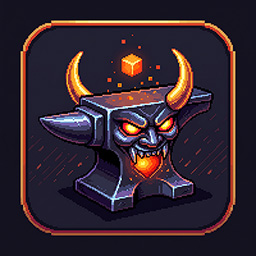
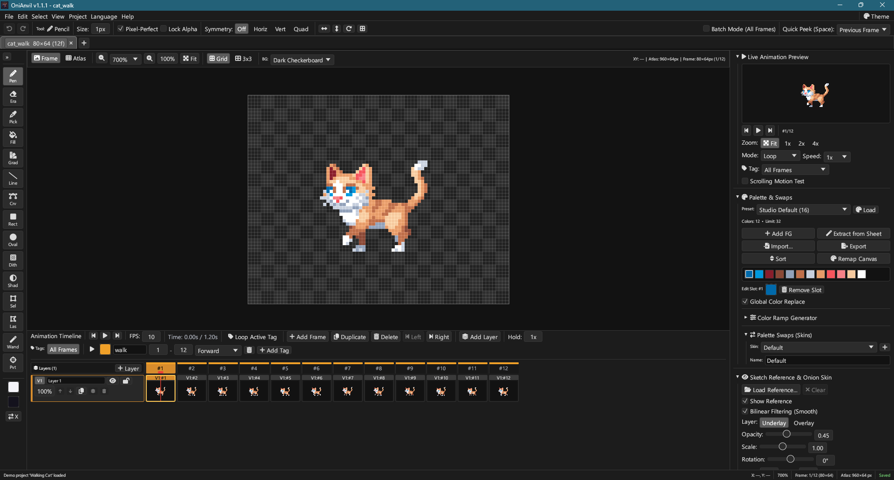
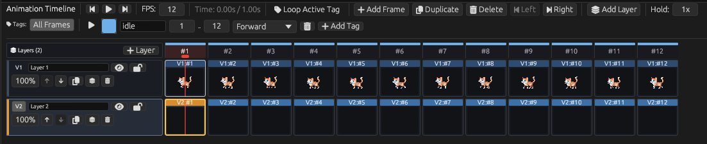
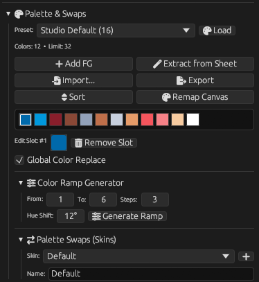
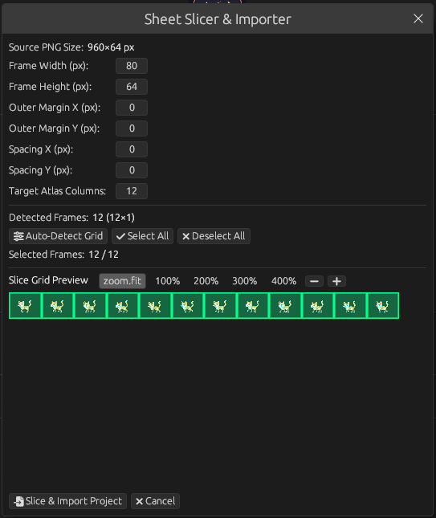
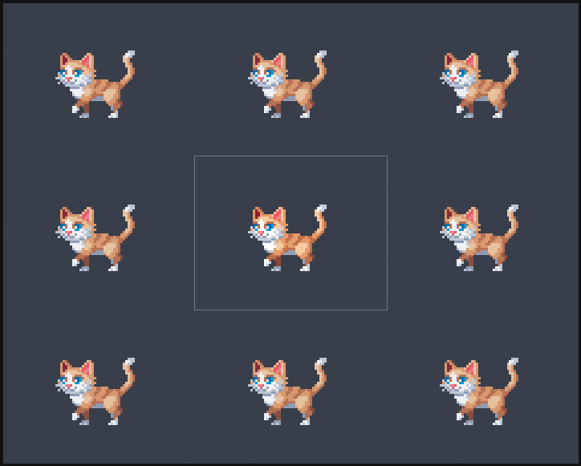
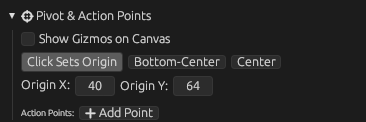

# OniAnvil

**ゲーム用スプライトアトラスに最適化されたピクセルアート＆オニオンスキンアニメーションスタジオ**

[-yellow?logo=webassembly)](https://rbm13s.github.io/OniAnvil/app/?lang=ja)

 

👉 **[🚀 Try OniAnvil in Browser (WebAssembly)](https://rbm13s.github.io/OniAnvil/app/?lang=ja)** *(⚠️ Experimental build: may contain WebGL/WASM limitations and bugs)* • **[🌐 Official Documentation Website](https://rbm13s.github.io/OniAnvil/ja.html)**

 

**Languages / Языки / Мови / Sprachen / 语言:** 
[English](../README.md) •
[Русский](README-ru.md) •
[Українська](README-uk.md) •
[Беларуская](README-be.md) •
[Қазақша](README-kk.md) •
[ქართული](README-ka.md) •
[Հայերեն](README-hy.md) •
[Azərbaycan](README-az.md) •
[Oʻzbekcha](README-uz.md) •
[Deutsch](README-de.md) •
[Français](README-fr.md) •
[Español](README-es.md) •
[Italiano](README-it.md) •
[Português](README-pt.md) •
[Polski](README-pl.md) •
[Čeština](README-cs.md) •
[Slovenčina](README-sk.md) •
[Slovenščina](README-sl.md) •
[Български](README-bg.md) •
[Српски](README-sr.md) •
[Hrvatski](README-hr.md) •
[Nederlands](README-nl.md) •
[Dansk](README-da.md) •
[Norsk](README-no.md) •
[Svenska](README-sv.md) •
[Suomi](README-fi.md) •
[Eesti](README-et.md) •
[Latviešu](README-lv.md) •
[Lietuvių](README-lt.md) •
[Magyar](README-hu.md) •
[Română](README-ro.md) •
[Türkçe](README-tr.md) •
[Ελληνικά](README-el.md) •
[简体中文](README-zh-cn.md) •
[繁體中文](README-zh-tw.md) •
**日本語** •
[한국어](README-ko.md)

---

## ゲーム用スプライトアトラスに最適化されたピクセルアート＆オニオンスキンアニメーションスタジオ

Rustで書かれた高性能クロスプラットフォームピクセルアートワークステーション。マルチトラックレイヤータイムライン、オニオンスキン、下絵トレース、パレットスワップ、ゲームエンジン書き出しに対応。

### Visual Tour

| Workspace | Timeline & Layers | Palette & Color Swaps |
|:---:|:---:|:---:|
|  |  |  |
| **Workspace & Canvas** | **Multi-Track Studio Timeline** | **Palette Editor & Swaps** |

| Sheet Slicer | 3x3 UI Margins | Rotation Pivot & Sockets |
|:---:|:---:|:---:|
|  |  |  |
| **Automatic Sheet Slicer** | **9-Slice Scalable UI** | **Origin Pivot & Custom Sockets** |

---

## Comprehensive Tools Reference

| Icon | Tool | Shortcut | Options | Description |
|:---:|:---|:---:|:---|:---|
| `\u{f303}` | **Pencil** | <kbd>P</kbd> | 1–64 px, Pixel-Perfect | 1px precision raster drawing. Pixel-Perfect algorithm eliminates unwanted staircase corners. |
| `\u{f12d}` | **Eraser** | <kbd>E</kbd> | 1–64 px | Removes pixel color data back to pure alpha transparency on active layer. |
| `\u{f1fb}` | **Eyedropper** | <kbd>I</kbd> / <kbd>Alt</kbd> | Canvas / Sketch | Real-time pixel color sampling. Left-click sets Primary color; Right-click sets Secondary color. |
| `\u{f576}` | **Paint Bucket** | <kbd>G</kbd> | Tolerance 0–255, 4/8-way | Flood fills connected color regions or all matching pixels on the canvas. |
| `\u{f5c3}` | **Gradient** | <kbd>U</kbd> | Linear / Radial, Dither | Interactive two-point gradient interpolation with optional retro Bayer pattern dithering. |
| `\u{f715}` | **Line** | <kbd>V</kbd> | 1–64 px, Shift-Snap | Bresenham straight line rasterizer with live rubber-banding preview. |
| `\u{f55b}` | **Bézier Curve** | <kbd>C</kbd> | 1–64 px, 3-point | Three-point quadratic Bézier curve: start point, end point, and middle control node. |
| `\u{f0c8}` | **Rectangle** | <kbd>R</kbd> | Outline / Solid / Both | Geometric box tool. Holding <kbd>Shift</kbd> constrains to a 1:1 square. |
| `\u{f111}` | **Ellipse** | <kbd>O</kbd> | Outline / Solid / Both | Midpoint ellipse and circle rasterizer. Holding <kbd>Shift</kbd> forces an equidistant circle. |
| `\u{f43c}` | **Dither Brush** | <kbd>D</kbd> | Bayer 2×2 / 4×4 / 8×8 | Authentic retro hardware shading alternating primary and secondary pixels. |
| `\u{f042}` | **Shading** | <kbd>H</kbd> | Lighten / Darken | Steps pixel colors up or down within color ramps defined in the current palette. |
| `\u{f5cb}` | **Rect Select** | <kbd>M</kbd> | Marching Ants, Clipboard | Defines rectangular pixel bounding boxes with animated marching ants boundary. |
| `\u{f5ee}` | **Lasso Select** | <kbd>L</kbd> | Freehand Polygon | Freeform polygonal selection tool to isolate complex silhouettes. |
| `\u{f0d0}` | **Magic Wand** | <kbd>W</kbd> | Tolerance 0–255 | Selects color-contiguous or canvas-wide pixel clusters matching clicked pixel color. |
| `\u{f05b}` | **Pivot & Sockets** | <kbd>Y</kbd> | Center, Named Sockets | Sets frame rotation pivot center and assigns custom named socket points (`muzzle`, `grip`). |

---

## Key Features

1. **Dual Atlas-Centric Architecture**: The game sprite atlas texture is the single source of truth.
2. **Multi-Track Layer Timeline**: Independent tracks (`V1, V2, V3...`), duration multipliers, linked frames, and loop tags.
3. **Real-Time Live Preview**: Floating preview window with FPS control, playback loop, and zoom.
4. **Configurable Onion Skinning**: Multi-frame ghosting with independent red/blue tinting and opacity falloff.
5. **Reference Sketch Underlay**: Load PNG/JPEG/WebP concept art as an underlay with free pan, zoom, and eyedropper sampling.
6. **Live FX & RotSprite**: HSV adjustment, automatic pixel outline generator, 3x3 convolution filters, and RotSprite rotation.
7. **Palette Management & Skins**: Day/Night variants, team colors, and GPL/HEX palette import/export.
8. **Sheet Slicer & 9-Slice UI**: Auto-detect sprite boundaries and configure 9-slice scalable UI margins.
9. **Game Engine Ready Export**: Scaled PNGs with extruded borders, animated GIFs, and JSON metadata (Godot, Bevy, Raylib).
10. **35 Retro & Modern Themes**: CRT Amber, CRT Green, Famicom, Mega Drive, Game Boy, PSX, and sleek studio dark/light themes.

---

## Keyboard Shortcuts

| Shortcut | Tool / Action | Description |
|:---:|:---|:---|
| <kbd>P</kbd> | Pencil | 1px precision raster drawing |
| <kbd>E</kbd> | Eraser | Clear pixels back to transparency |
| <kbd>I</kbd> / <kbd>Alt</kbd> | Eyedropper | Sample color from canvas or sketch |
| <kbd>G</kbd> | Paint Bucket | Flood fill contiguous color region |
| <kbd>U</kbd> | Gradient | Linear and radial gradients |
| <kbd>V</kbd> | Line | Straight lines with angle snapping |
| <kbd>C</kbd> | Bézier Curve | Smooth 3-point quadratic spline |
| <kbd>R</kbd> | Rectangle | Outlined or solid rectangular shapes |
| <kbd>O</kbd> | Ellipse | Outlined or solid circles and ellipses |
| <kbd>D</kbd> | Dither Brush | Pattern dither drawing |
| <kbd>H</kbd> | Shading | Step lighter or darker through palette ramps |
| <kbd>M</kbd> | Rectangular Select | Select region with marching ants |
| <kbd>L</kbd> | Lasso Select | Freehand polygon selection |
| <kbd>W</kbd> | Magic Wand | Select color-contiguous pixels |
| <kbd>Y</kbd> | Pivot & Sockets | Rotation center and socket points |
| <kbd>X</kbd> | Swap Swatches | Swap Primary and Secondary color swatches |
| <kbd>Ctrl+C / X / V</kbd> | Clipboard | Copy, cut, and paste pixel clusters |
| <kbd>Space</kbd> | Play / Pause | Toggle animation playback |
| <kbd>A / D</kbd> | Step Frames | Step to Previous / Next frame |
| <kbd>Shift+R</kbd> | Replace Color | Interactive color replacement dialog |
| <kbd>Ctrl+U</kbd> | Color Adjust | HSV hue shift and contrast adjustment |
| <kbd>Ctrl+R</kbd> | Free Rotate | Arbitrary angle rotation via RotSprite |
| <kbd>Space+Drag</kbd> | Pan Canvas | Smooth infinite panning |
| <kbd>Ctrl+Wheel</kbd> | Zoom | Pixel-crisp cursor-centered zoom |

---

## Getting Started

### Standalone Binaries
- **Windows**: Download `OniAnvil-windows-x86_64.zip`, extract, and launch `onianvil.exe`.
- **Linux**: Download `OniAnvil-linux-x86_64.tar.gz` (portable) or install `onianvil_*_amd64.deb`.
- **macOS**: Download `OniAnvil-macos-universal.zip`, extract, and drag `OniAnvil.app` to Applications.
- **Web**: Run directly in your browser without installing anything: **[Launch WebAssembly App](https://rbm13s.github.io/OniAnvil/app/?lang=ja)**.
  > [!WARNING]
  > The WebAssembly (browser) build has an **Experimental** status. Due to browser sandbox constraints, WebGL/WebGPU differences, and clipboard limitations, you may encounter minor graphical glitches or performance bottlenecks. For production work, native desktop builds are strongly recommended.

---

## License & Disclaimer

This project is licensed under the **[MIT License](../LICENSE)**.

### Disclaimer of Warranty & Limitation of Liability
> [!IMPORTANT]
> **OniAnvil** is distributed **free of charge** on an **"AS IS"** and **"AS AVAILABLE"** basis, without warranties or conditions of any kind, either express or implied.
> 
> Under no circumstances shall the author(s), copyright holders, or contributors be held liable for any direct, indirect, incidental, special, exemplary, or consequential damages (including, but not limited to, loss of data, file corruption, hardware failure, lost profits, or business interruption) arising in any way out of the use of or inability to use this software. You assume all responsibility and risk for using this program.
